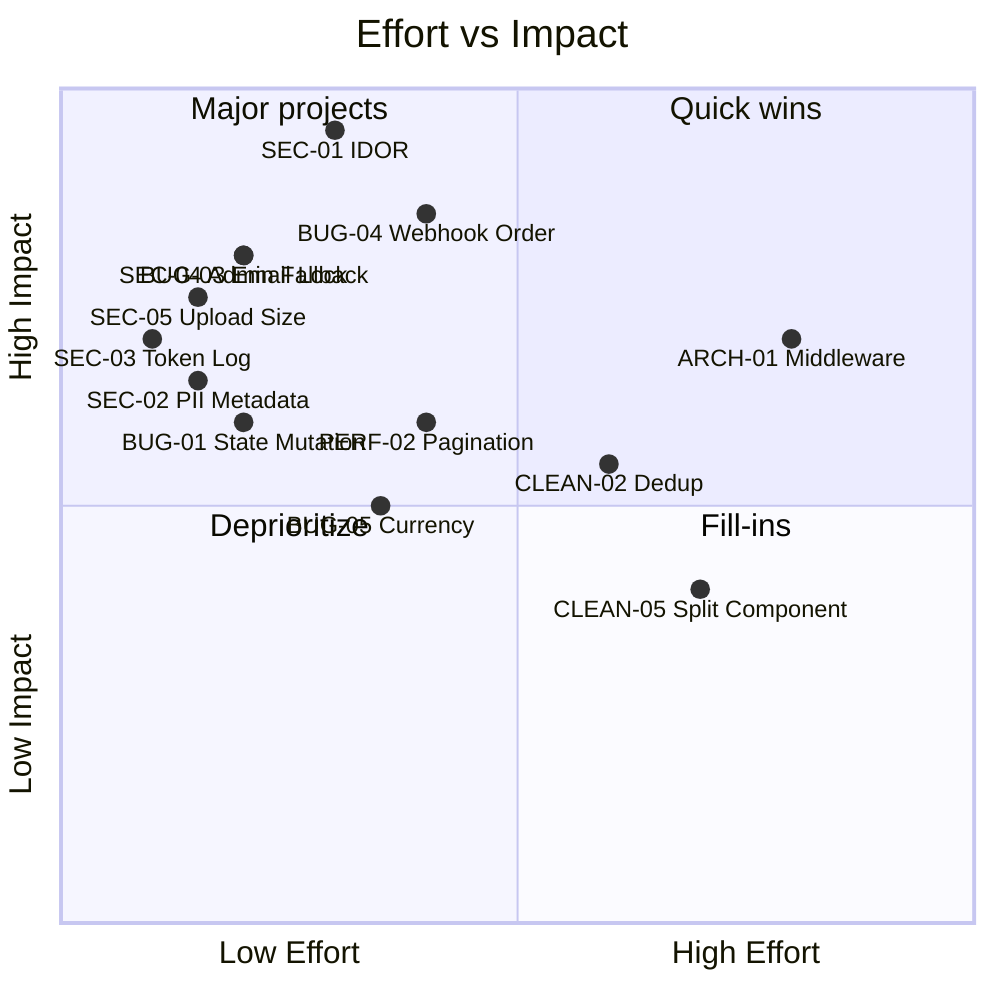

# AiBDE Codebase — Senior Engineer Code Review

> **Reviewer:** Antigravity AI · **Date:** 2026-03-30  
> **Stack:** Next.js 16 · React 19 · Supabase · Clerk · Dodo Payments · R2 · Upstash Redis  
> **Scope:** Full codebase review — security, bugs, performance, scalability, clean code

---

## Executive Summary

The AiBDE codebase is a **production-grade Next.js AI tool directory** with a submission-and-payment flow. Overall architecture is reasonable: Clerk for auth, Supabase for data, Dodo for payments, R2 for storage, Upstash Redis for rate limiting, and Turnstile for bot protection.

However, there are **critical security vulnerabilities**, **data-integrity bugs**, **performance bottlenecks**, and **several clean-code concerns** that need attention before scaling. This review categorizes findings by severity.

---

## Severity Legend

| Emoji | Level | Meaning |
|-------|-------|---------|
| 🔴 | **CRITICAL** | Security vulnerability or data-loss bug — fix immediately |
| 🟠 | **HIGH** | Significant bug, integrity risk, or performance concern |
| 🟡 | **MEDIUM** | Code smell, fragility, or moderate risk |
| 🟢 | **LOW** | Style, maintainability, or minor improvement |

---

## 1. Security Issues

### 🔴 SEC-01: Payment Retry Endpoint Has No Authentication (IDOR)

**File:** [route.ts](file:///c:/Users/eswar/Desktop/aibde-webapp/src/app/api/payments/retry/route.ts#L29-L77)

The `/api/payments/retry` endpoint accepts a `submissionId` from the request body and creates a new Dodo checkout session **without verifying the caller's identity**. Any attacker who guesses (or enumerates) a valid UUID can:

1. View payment metadata (tool name, email, plan) via the Dodo session
2. Trigger unlimited checkout sessions, potentially racking up Dodo API usage
3. Initiate payment flows for other users' submissions

```typescript
// CURRENT — no auth check at all
const { submissionId, baseUrl: clientBaseUrl } =
    (await request.json().catch(() => null)) || {};
```

**Fix:** Verify the caller owns the submission. Options:
- Match `submitter_email` from the payment against a session/token the user provides
- Require the Turnstile token to at least prevent automated abuse
- Or require the `aibde_voter_id` cookie + IP match against the original submission

---

### 🔴 SEC-02: PII Leaked in Payment Metadata

**File:** [route.ts](file:///c:/Users/eswar/Desktop/aibde-webapp/src/app/api/payments/retry/route.ts#L148-L154) and [route.ts](file:///c:/Users/eswar/Desktop/aibde-webapp/src/app/api/submit-tool/route.ts#L324-L330)

Both the submit-tool and retry routes send `email: formData.submitterEmail` in the Dodo checkout metadata. This stores raw PII in a third-party system. If Dodo's logs are ever compromised, all submitter emails are exposed.

```typescript
metadata: {
    submission_id: submissionId,
    payment_id: newPayment.id,
    tool_name: latestPayment.tool_name,
    email: latestPayment.submitter_email, // ← PII in third-party metadata
    plan: latestPayment.plan,
},
```

**Fix:** Remove `email` from metadata entirely (it's already in Dodo's `customer` object). If needed for reconciliation, use a hashed/pseudonymized value.

---

### 🔴 SEC-03: Device Token Logged in Plaintext

**File:** [route.ts](file:///c:/Users/eswar/Desktop/aibde-webapp/src/app/api/vote/route.ts#L20-L22)

The vote API logs the generated device token in a `console.warn`. This token is used for rate-limiting and is bound to a cookie. Logging it creates a leak vector if server logs are captured.

```typescript
console.warn(`[Vote API] IP anonymous or absent. Using generated device token for rate limiting: ${deviceToken}`);
```

**Fix:** Log a generic message instead:
```typescript
console.warn('[Vote API] IP anonymous or absent. Using generated device token for rate limiting.');
```

---

### 🟠 SEC-04: `supabaseAdmin` Silently Falls Back to Anon Client

**File:** [supabase.ts](file:///c:/Users/eswar/Desktop/aibde-webapp/src/lib/supabase.ts#L24-L28)

If `SUPABASE_SERVICE_ROLE_KEY` is missing, `supabaseAdmin` silently falls back to the anon client. This means **all admin API routes execute with RLS-restricted permissions**, potentially returning empty results or silently failing — a very hard-to-debug production failure.

```typescript
export const supabaseAdmin = supabaseServiceRoleKey
    ? createClient(supabaseUrl, supabaseServiceRoleKey, { ... })
    : supabase; // ← Silently degrades to anon client
```

**Fix:** In production, throw an error instead of a silent fallback:
```typescript
export const supabaseAdmin = supabaseServiceRoleKey
    ? createClient(supabaseUrl, supabaseServiceRoleKey, {
        auth: { autoRefreshToken: false, persistSession: false }
    })
    : (() => {
        if (process.env.NODE_ENV === 'production') {
            throw new Error('[FATAL] SUPABASE_SERVICE_ROLE_KEY is required in production');
        }
        console.warn('[Supabase] No service role key — using anon client (dev only)');
        return supabase;
    })();
```

---

### 🟠 SEC-05: Upload Trusts Client-Provided `file.size`

**File:** [route.ts](file:///c:/Users/eswar/Desktop/aibde-webapp/src/app/api/public/upload-logo/route.ts#L39-L43)

The upload handler checks `file.size` before reading the buffer, but `file.size` is client-controlled. An attacker could spoof a small `file.size` while sending a 100MB payload.

```typescript
if (file.size > MAX_SIZE) {  // ← Client-controlled, untrustworthy
    return NextResponse.json({ error: 'File too large' }, { status: 400 });
}
const buffer = Buffer.from(await file.arrayBuffer());  // ← Actual payload could be huge
```

**Fix:** Also validate `buffer.length` after reading:
```typescript
const buffer = Buffer.from(await file.arrayBuffer());
if (buffer.length > MAX_SIZE) {
    return NextResponse.json({ error: 'File too large. Maximum size: 5MB' }, { status: 400 });
}
```

---

### 🟡 SEC-06: CSP Allows `unsafe-eval` in Production

**File:** [next.config.js](file:///c:/Users/eswar/Desktop/aibde-webapp/next.config.js#L27)

The Content Security Policy includes `'unsafe-eval'` unconditionally. While necessary for some SDKs, it significantly weakens XSS protection. Consider restricting `unsafe-eval` to development only, or using nonce-based CSP for scripts.

---

### 🟡 SEC-07: HTML Description Not Sanitized Server-Side

**File:** [validations.ts](file:///c:/Users/eswar/Desktop/aibde-webapp/src/lib/validations.ts#L19-L23)

The comment says "HTML sanitization handled client-side via SafeHtml/DOMPurify". This is only safe if the admin dashboard is the only place HTML is rendered. If descriptions are ever rendered server-side or in emails without DOMPurify, stored XSS is possible.

**Recommendation:** Add a lightweight server-side sanitization pass (e.g., strip `<script>` tags at minimum) before storing in the database.

---

## 2. Bugs

### 🔴 BUG-01: State Mutation in Dynamic List Handlers

**File:** [page.tsx](file:///c:/Users/eswar/Desktop/aibde-webapp/src/app/submit/page.tsx#L865) and [page.tsx](file:///c:/Users/eswar/Desktop/aibde-webapp/src/app/submit/page.tsx#L893)

The video and screenshot URL handlers mutate objects **in place** within the React state array. Spreading the array (`[...videoUrls]`) creates a shallow copy, but `next[idx].url = e.target.value` mutates the original object reference. This can cause React to skip re-renders or produce stale closures.

```typescript
// CURRENT — mutates the original object
onChange={(e) => { const next = [...videoUrls]; next[idx].url = e.target.value; setVideoUrls(next); }}
```

**Fix:** Create a new object for the changed index:
```typescript
onChange={(e) => {
    setVideoUrls(prev => prev.map((item, i) =>
        i === idx ? { ...item, url: e.target.value } : item
    ));
}}
```

---

### 🟠 BUG-02: Non-Atomic DB Updates Can Leave Inconsistent State

**File:** [page.tsx](file:///c:/Users/eswar/Desktop/aibde-webapp/src/app/submit/result/%5Bsubmission_id%5D/page.tsx#L152-L173)

The result page uses `Promise.all()` to update both the `payments` and `tool_submissions` tables. If one update succeeds and the other fails, the database is left in an inconsistent state (e.g., payment shows "success" but submission still shows "initiated").

```typescript
await Promise.all([
    supabaseAdmin.from('payments').update({status: 'success', ...}).eq('id', payment.id),
    supabaseAdmin.from('tool_submissions').update({payment_status: 'success'}).eq('id', payment.submission_id)
]);
```

**Fix:** Either use a Supabase RPC with a DB transaction, or implement compensating logic — check each result individually and roll back the successful one if the other fails.

---

### 🟠 BUG-03: Email Lock Never Cleared on Failure

**File:** [page.tsx](file:///c:/Users/eswar/Desktop/aibde-webapp/src/app/submit/result/%5Bsubmission_id%5D/page.tsx#L176-L209)

If `sendSubmissionEmail` throws, the `email_provider_id = 'sending_lock'` is never cleared. This permanently blocks email retries for that payment.

```typescript
// The lock is set...
.update({ email_provider_id: 'sending_lock' })

// But the catch block doesn't clear it:
} catch (emailErr) {
    console.error('[Submit Result] Email sending or tracking failed', emailErr);
    // ← Lock remains! No retry possible.
}
```

**Fix:** In the catch block, reset the lock:
```typescript
} catch (emailErr) {
    console.error('[Submit Result] Email sending or tracking failed', emailErr);
    await supabaseAdmin.from('payments')
        .update({ email_provider_id: null, email_status: 'failed' })
        .eq('id', payment.id)
        .eq('email_provider_id', 'sending_lock');
}
```

---

### 🟠 BUG-04: Webhook Returns 500 After Payment Already Claimed

**File:** [route.ts](file:///c:/Users/eswar/Desktop/aibde-webapp/src/app/api/dodo/webhook/route.ts#L304-L313)

The tool_submissions update happens **after** the payment has been claimed/finalized. If the submission update fails:
1. The webhook returns 500
2. Dodo retries the webhook
3. The retry finds the payment is already terminal and exits early
4. The submission status is **never** updated

```typescript
// Payment already claimed above (line ~238-255)

// This happens AFTER — if it fails, webhook returns 500 and Dodo retries,
// but retry exits at line 208-211 because payment is already terminal
const { error: submissionUpdateError } = await supabaseAdmin
    .from('tool_submissions')
    .update({ payment_status: statusFromEvent })
    .eq('id', existingPayment.submission_id);

if (submissionUpdateError) {
    return NextResponse.json({ received: false }, { status: 500 }); // ← retry won't help
}
```

**Fix:** Either:
- Move the submission update **before** the payment claim, or
- Make the submission update non-blocking (log failure, return 200, and handle via reconciliation)

---

### 🟡 BUG-05: Currency Scaling Uses Incomplete Zero-Decimal List

**File:** [route.ts](file:///c:/Users/eswar/Desktop/aibde-webapp/src/app/api/submit-tool/route.ts#L388-L396)

The submit-tool route uses a hardcoded currency list that's missing several zero-decimal currencies (ISK, HUF, TWD, CLP, RWF). The webhook handler has a slightly more complete list. These should be consolidated into a shared utility.

```typescript
// submit-tool/route.ts — missing ISK, TWD, etc.
if (['JPY', 'KRW', 'VND', 'UGX'].includes(c)) scale = 0;

// dodo/webhook/route.ts — better but still incomplete
if (['JPY', 'KRW', 'VND', 'ISK', 'TWD'].includes(currencyUpper)) return 0;
```

**Fix:** Create a shared `src/lib/currency.ts` module with a canonical mapping.

---

### 🟡 BUG-06: Tax/Net Amount Parsing Only Handles Numbers, Not Strings

**File:** [route.ts](file:///c:/Users/eswar/Desktop/aibde-webapp/src/app/api/dodo/webhook/route.ts#L146-L165)

The webhook correctly handles `amount` as both `number` and `string`, but `tax` and `net_amount` only handle `number`. If Dodo sends these as strings (which their API may do), tax data will be silently dropped.

**Fix:** Mirror the amount parsing pattern for tax and net_amount fields.

---

### 🟡 BUG-07: `submission-ref.ts` Uses `Math.random()` for IDs

**File:** [submission-ref.ts](file:///c:/Users/eswar/Desktop/aibde-webapp/src/lib/submission-ref.ts#L22-L26)

`Math.random()` is not cryptographically secure. With 36^5 = ~60M combinations and ~5K submissions/year this is unlikely to collide, but for a payment-related identifier it's better practice to use `crypto.getRandomValues()`.

```typescript
// CURRENT
seq += ALPHANUMERIC[Math.floor(Math.random() * ALPHANUMERIC.length)];
```

**Fix:**
```typescript
const bytes = crypto.getRandomValues(new Uint8Array(5));
const seq = Array.from(bytes, b => ALPHANUMERIC[b % ALPHANUMERIC.length]).join('');
```

---

## 3. Performance Issues

### 🟠 PERF-01: Levenshtein Distance Computed Client-Side per Keystroke

**File:** [search.ts](file:///c:/Users/eswar/Desktop/aibde-webapp/src/lib/search.ts#L13-L57)

The `similarity()` function runs O(n*m) Levenshtein computation for every tool against every query word on each keystroke. With 500+ tools and multiple fields, this creates thousands of matrix allocations per keystroke.

**Recommendation:**
- Add debouncing (250ms) on the search input
- Pre-compute name trigrams for faster fuzzy matching
- Consider using the server-side full-text search (PostgreSQL `ts_vector`) as the primary search, with this as a fallback

---

### 🟠 PERF-02: Dashboard Payments Fetches ALL Records Without Pagination

**File:** [route.ts](file:///c:/Users/eswar/Desktop/aibde-webapp/src/app/api/dashboard/payments/route.ts#L11-L14)

The dashboard payments route fetches **all payment records** without pagination. As the payments table grows, this will become incrementally slower and consume more memory.

```typescript
const { data: payments } = await supabaseAdmin
    .from('payments')
    .select('*')   // ← ALL columns
    .order('created_at', { ascending: false });  // ← ALL rows
```

**Fix:** Add pagination matching the same pattern used in `/api/tools`:
```typescript
const page = parseInt(searchParams.get('page') || '1', 10);
const limit = parseInt(searchParams.get('limit') || '50', 10);
```

---

### 🟠 PERF-03: `.in()` Query Without Chunking for Large Arrays

**File:** [route.ts](file:///c:/Users/eswar/Desktop/aibde-webapp/src/app/api/dashboard/payments/route.ts#L26-L29)

The `.in('id', submissionIds)` call can blow PostgreSQL parameter limits if `submissionIds` grows large (Supabase/PostgREST encodes each ID in the URL).

**Fix:** Chunk the array into batches of ~500, similar to how `/api/tools` does it:
```typescript
const BATCH = 500;
for (let i = 0; i < submissionIds.length; i += BATCH) {
    const batch = submissionIds.slice(i, i + BATCH);
    const { data } = await supabaseAdmin.from('tool_submissions')
        .select('id, submission_ref').in('id', batch);
    if (data) submissions.push(...data);
}
```

---

### 🟡 PERF-04: Tools API Makes N+1 Submission Lookups

**File:** [route.ts](file:///c:/Users/eswar/Desktop/aibde-webapp/src/app/api/tools/route.ts#L279-L307)

After fetching tools, the route makes additional batched queries to fetch submission refs. While batching mitigates the worst case, this is still an N/100 query pattern. Consider using a SQL `LEFT JOIN` via Supabase's foreign key relations or a database view.

---

### 🟡 PERF-05: `allData` Mode Can Load Entire Database

**File:** [route.ts](file:///c:/Users/eswar/Desktop/aibde-webapp/src/app/api/tools/route.ts#L214-L249)

The `?all=true` mode fetches all tools in a while loop. With thousands of tools, this can time out on serverless functions (10-30s limit) and consume excessive memory.

**Recommendation:** Limit `allData` mode to admin-only export functionality with streaming/pagination, or add a hard cap.

---

## 4. Scalability Concerns

### 🟠 SCALE-01: In-Memory Auth Cache on Serverless

**File:** [auth-utils.ts](file:///c:/Users/eswar/Desktop/aibde-webapp/src/lib/auth-utils.ts#L34-L37)

The `userCache` and `inflightRequests` Maps live in module-level memory. On serverless (Vercel), each cold start creates a fresh cache. The caching only helps within a single function instance's lifetime, which is typically 5-15 minutes. This is fine for burst requests but won't effectively reduce Clerk API calls at scale.

**Recommendation:** If Clerk 429s become a problem, consider edge-cached tokens or Clerk's session claims (which contain metadata) instead of fetching the user on every admin request.

---

### 🟡 SCALE-02: `sync-counts` Scans All Published Tools In-Memory

**File:** [route.ts](file:///c:/Users/eswar/Desktop/aibde-webapp/src/app/api/sync-counts/route.ts#L31-L58)

The sync endpoint loads ALL published tools into memory to count categories/tasks. With 10K+ tools, this will allocate a large array. Consider using a PostgreSQL `GROUP BY` query instead:

```sql
SELECT unnest(category_name) AS cat, COUNT(*) 
FROM tools WHERE status = 'published' 
GROUP BY cat;
```

---

### 🟡 SCALE-03: PostgREST String Building for `.not('in', ...)` is Fragile

**File:** [route.ts](file:///c:/Users/eswar/Desktop/aibde-webapp/src/app/api/sync-counts/route.ts#L83-L94)

The manual string construction for the PostgREST `in` filter is fragile and can break on category/task names containing special characters (quotes, commas, parentheses).

```typescript
.not('category_name', 'in', `(${activeNames.map(n => `"${n.replace(/"/g, '\\"')}"`).join(',')})`)
```

**Fix:** The Supabase JS client supports passing an array directly to `.not()` — update to use that API. If not supported, use a different approach (e.g., delete-then-upsert).

---

## 5. Clean Code Issues

### 🟡 CLEAN-01: Excessive Use of `any` Type

Many files use `any` extensively, undermining TypeScript's value:

| File | Count | Worst offenders |
|------|-------|-----------------|
| [tools/route.ts](file:///c:/Users/eswar/Desktop/aibde-webapp/src/app/api/tools/route.ts) | 10+ | `let data: any[]`, query builders |
| [submit/result/page.tsx](file:///c:/Users/eswar/Desktop/aibde-webapp/src/app/submit/result/%5Bsubmission_id%5D/page.tsx) | 5+ | `payment: any`, `dodoPayment: any` |
| [dodo/webhook/route.ts](file:///c:/Users/eswar/Desktop/aibde-webapp/src/app/api/dodo/webhook/route.ts) | 3+ | `payload: any` |

**Fix:** Create proper TypeScript interfaces for payment records, Dodo API responses, and DB results. Start with the most critical paths (webhook, payments).

---

### 🟡 CLEAN-02: Duplicate Code Across Payment Routes

The following patterns are duplicated across `submit-tool`, `payments/retry`, and `submit/result`:
- Currency scaling logic (3 separate implementations)
- Dodo timeout handling (AbortController + cleanup)
- `isAllowedRedirectOrigin()` function (exact duplicate)
- Payment status update error handling

**Fix:** Extract shared utilities:
```
src/lib/currency.ts     — getCurrencyMinorUnits(), convertMinorToMajor()
src/lib/dodo.ts          — createDodoCheckout(), validateDodoPayment()
src/lib/redirect.ts      — isAllowedRedirectOrigin()
```

---

### 🟡 CLEAN-03: `dbToolToCardTool` Defined Twice

**File:** [supabase.ts](file:///c:/Users/eswar/Desktop/aibde-webapp/src/lib/supabase.ts#L358) and [tools/route.ts](file:///c:/Users/eswar/Desktop/aibde-webapp/src/app/api/tools/route.ts#L12)

There are two different `dbToolToCardTool` functions — one in `supabase.ts` (exported) and one in `tools/route.ts` (local). They map different fields and serve different purposes but have the same name. This is confusing and error-prone.

**Fix:** Rename the route-local one to `dbToolToDashboardCard` and add a comment clarifying the distinction.

---

### 🟡 CLEAN-04: Inconsistent Error Handling Patterns

Some routes use `console.error` + return, others use `console.warn`, and a few silently swallow errors:

```typescript
// Pattern 1: Proper error handling ✅
if (error) {
    console.error('[Dodo Webhook] Failed to update payment', error);
    return NextResponse.json({ received: false }, { status: 500 });
}

// Pattern 2: Silent swallow ❌ (tools/route.ts line 287-291)
const { data: subs } = await supabaseAdmin...;  // error ignored!

// Pattern 3: Empty catch ❌ (submit/page.tsx)
.catch(() => { });
```

**Fix:** Adopt a consistent pattern. At minimum, always destructure and log errors from Supabase calls.

---

### 🟢 CLEAN-05: Massive Component File

**File:** [submit/page.tsx](file:///c:/Users/eswar/Desktop/aibde-webapp/src/app/submit/page.tsx) — **1,211 lines**

This single file contains the entire submit page including: multiple sub-components, form logic, API calls, animation components, plan definitions, and review data. It should be decomposed into:

```
submit/
├── page.tsx              — Layout + Suspense wrapper
├── components/
│   ├── SubmitForm.tsx     — Form logic + handlers
│   ├── PlanSelector.tsx   — Pricing plan cards
│   ├── FounderReviews.tsx — Testimonials section
│   ├── MarqueeCards.tsx   — Recent tools marquee
│   └── Counter.tsx        — Animated counter
├── constants.ts           — PLANS, CATEGORIES, PRICING_OPTIONS
└── types.ts               — FormData, RecentTool interfaces
```

---

### 🟢 CLEAN-06: `proxy.ts` Naming

The middleware file is named `proxy.ts` and exports `proxy` instead of the standard Next.js naming convention (`middleware.ts` / default export). While this works via the `next.config.js` re-export, it adds indirection. Consider renaming to `middleware.ts` for better discoverability.

---

### 🟢 CLEAN-07: `@types/react` Version Mismatch

**File:** [package.json](file:///c:/Users/eswar/Desktop/aibde-webapp/package.json#L51)

The project uses React 19 (`"react": "^19.2.3"`) but has `@types/react` at `"^18.3.28"`. This can cause type errors or missing type definitions for React 19 features.

**Fix:** Update to `@types/react@^19`.

---

## 6. Architectural Recommendations

### ARCH-01: Add Request Validation Middleware

Currently, each API route manually validates request bodies, checks auth, and applies rate limiting independently. This leads to inconsistency. Consider a shared middleware pattern:

```typescript
// lib/api-handler.ts
export function createApiHandler(options: {
    auth: 'admin' | 'public' | 'authenticated';
    rateLimit: keyof typeof rateLimits;
    schema?: ZodSchema;
}) {
    return (handler: (req, validatedBody) => Promise<NextResponse>) => {
        return async (req: NextRequest) => {
            // 1. Auth check
            // 2. Rate limit
            // 3. Schema validation
            // 4. Call handler
        };
    };
}
```

### ARCH-02: Centralize Payment Status Machine

Payment status transitions (`initiated → success | failed`) are managed ad-hoc across 4 files. Introduce a status machine or at least a shared function:

```typescript
// lib/payment-status.ts
export async function transitionPaymentStatus(
    paymentId: string,
    from: PaymentStatus,
    to: PaymentStatus,
    updateData: Partial<Payment>
): Promise<{ success: boolean; error?: string }>
```

### ARCH-03: Database Types Should Be Auto-Generated

The `DbTool` interface is manually maintained with 50+ fields. Use Supabase's CLI to generate types:
```bash
npx supabase gen types typescript --project-id YOUR_PROJECT_ID
```

---

## Priority Matrix



---

## Recommended Fix Order

> [!IMPORTANT]
> Fix these in batches. Each batch can be a single PR.

### Batch 1 — Critical Security (1-2 hours)
1. **SEC-01** — Add auth/ownership check to `/api/payments/retry`
2. **SEC-02** — Remove PII from Dodo metadata
3. **SEC-03** — Redact device token from logs
4. **SEC-04** — Make `supabaseAdmin` throw in production if key is missing
5. **SEC-05** — Validate `buffer.length` in upload handler

### Batch 2 — Data Integrity Bugs (2-3 hours)
1. **BUG-01** — Fix state mutation in submit form
2. **BUG-03** — Clear email lock on failure
3. **BUG-04** — Reorder webhook: update submission before claiming payment
4. **BUG-05** — Create shared currency utilities
5. **BUG-06** — Handle string types in tax/net parsing

### Batch 3 — Performance (2-3 hours)
1. **PERF-02** — Add pagination to dashboard payments
2. **PERF-03** — Chunk `.in()` queries
3. **PERF-01** — Add debouncing to client-side search

### Batch 4 — Architecture & Clean Code (ongoing)
1. **CLEAN-02** — Extract shared Dodo/currency/redirect utilities
2. **CLEAN-01** — Add proper TypeScript types for payment flows
3. **CLEAN-05** — Decompose the 1200-line submit page
4. **ARCH-02** — Centralize payment status transitions

---

## What's Done Well ✅

To be fair, here's what the codebase does right:

| Area | Assessment |
|------|------------|
| **Webhook idempotency** | Excellent. Uses optimistic locking (`.eq('status', existingPayment.status)`) to prevent duplicate processing |
| **Rate limiting architecture** | Solid. Fail-closed design, Redis-backed with fallback, per-endpoint presets |
| **Middleware security** | Well-designed hidden login flow with HMAC-signed cookies and constant-time comparison |
| **Turnstile integration** | Proper server-side verification with timeout handling |
| **File upload validation** | Good. Validates actual file bytes via `file-type`, not just MIME headers |
| **CDN path handling** | Clean abstraction with `toFullUrl` / `toRelativePath` for portable path storage |
| **Error rollback** | Submit-tool route has proper rollback logic (deletes submission if payment insert fails) |
| **ISR cache busting** | `revalidatePath()` is called after mutations to ensure fresh content |
| **Security headers** | Comprehensive CSP, X-Frame-Options DENY, HSTS upgrade |

---

*End of review. Total findings: 7 security · 7 bugs · 5 performance · 7 clean code · 3 architecture = **29 findings**.*
